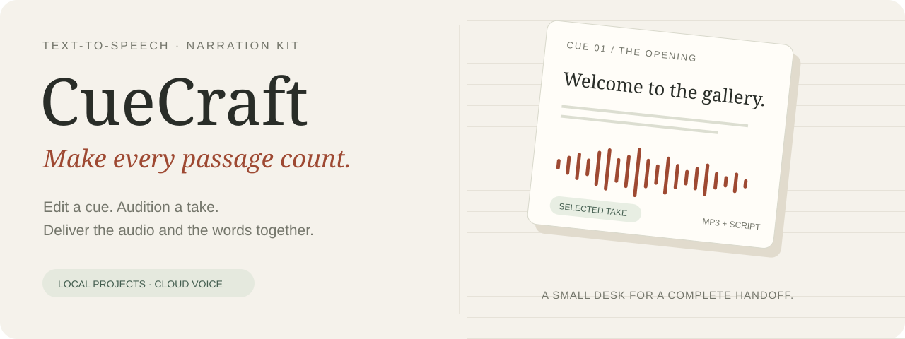
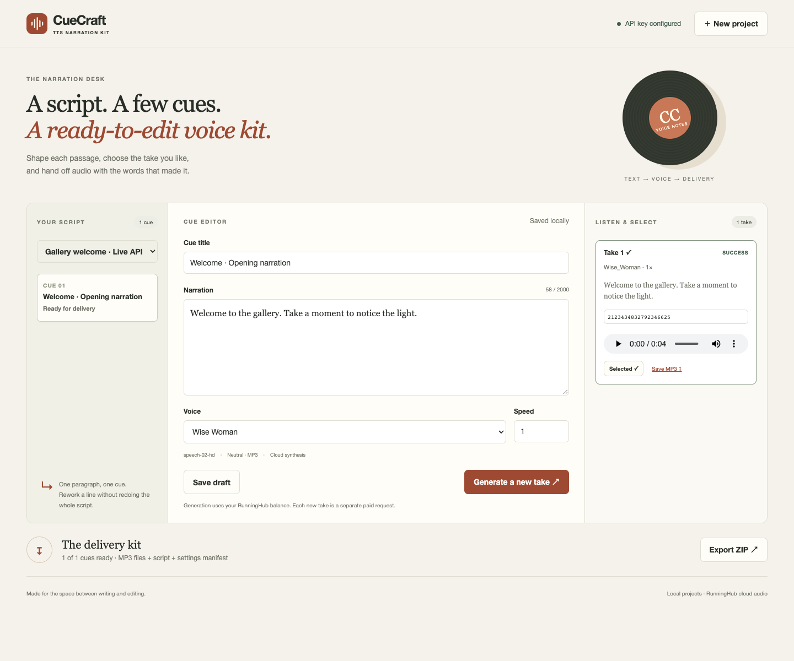
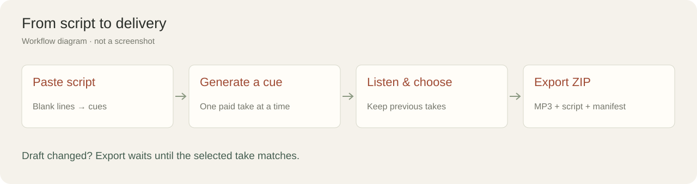
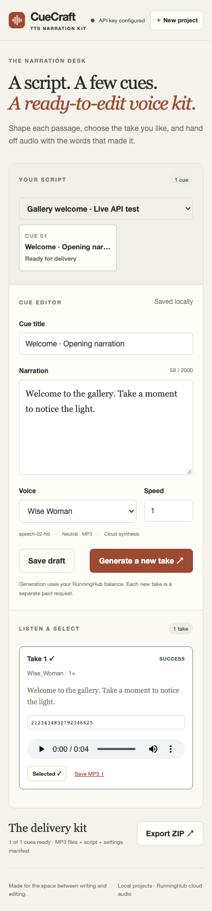

# CueCraft · TTS Narration Kit

[简体中文](README.md) · [English](README.en.md) · [日本語](README.ja.md)



**Turn a script into a narration kit you can audition, select, and hand off.** CueCraft is a local TTS (text-to-speech) tool powered by RunningHub's multimodal API: paste text → generate individual cues → choose takes → export numbered audio, the script, and a settings manifest.

Built for course narration, museum guides, and short video voiceovers. No GPU or local speech model is required; RunningHub `speech-02-hd` performs synthesis in the cloud.

[Features](#features) · [Install](#install) · [First project](#first-use) · [Settings](#settings) · [Recovery](#recovery) · [API](#api) · [Data](#data) · [FAQ](#faq) · [Validation](#validation) · [Partnership](#sponsor)

## Interface and workflow



This is a screenshot of the actual application after a real API call. The interface is in English; all three guides cover the same functionality. The displayed task ID is a test task identifier, not an API key.



<details><summary>Actual mobile layout</summary>



</details>

<a id="features"></a>

## Implemented features

- Split scripts at blank lines into cues. Keep multiple local projects and edit each cue's title, text, voice, and speed.
- Generate one cue at a time, without background batch spending. Keep previous takes, audition them, and choose a delivery version.
- Preserve an immutable settings snapshot for every take. Editing a saved draft marks mismatched takes as stale; export requires every selected take to match the current saved text, voice, and speed.
- Keep task IDs and take history in local SQLite. Refresh or restart and continue querying without resubmitting.
- Save successful audio locally; play it in the page, download an MP3, or export a complete ZIP.
- Prepare scripts even without an API key. Credentials stay on the server.

This is not a full ebook converter. It does not clone voices, edit or mix audio, align subtitles, translate, play cues continuously, or concatenate files. Each cue is a separate file in the ZIP.

<a id="install"></a>

## Install and run

### Requirements

- **Python 3.10+**, pip, and a modern browser.
- A valid RunningHub API key with model access and available balance.
- Network access to RunningHub and its audio CDN.

After obtaining the project files, enter the `cuecraft-tts-studio` directory containing `app.py`. No Node.js, frontend build, or ComfyUI installation is needed.

**macOS / Linux:**

```bash
cd cuecraft-tts-studio
python3 -m venv .venv
source .venv/bin/activate
python -m pip install -r requirements.txt
cp .env.example .env
```

**Windows PowerShell:**

```powershell
cd cuecraft-tts-studio
py -3 -m venv .venv
.\.venv\Scripts\python.exe -m pip install -r requirements.txt
Copy-Item .env.example .env
```

Open `.env` in a text editor, add your key after `RUNNINGHUB_API_KEY=`, and save. Do not overwrite an existing configuration. The default API region is `https://www.runninghub.cn`; international accounts can use `https://www.runninghub.ai`. Use the region that matches your credentials.

**Start from the same project directory:**

```bash
# macOS / Linux, with the virtual environment activated
python app.py
```

```powershell
# Windows PowerShell; no activation script required
.\.venv\Scripts\python.exe app.py
```

Open **http://127.0.0.1:8791**. The program uses `python-dotenv` to load the project's `.env`; existing process environment variables take precedence. Restart after changing configuration. “API key configured” only confirms the presence of a key, not successful authentication, credit, or model access.

The server binds to `127.0.0.1` for personal local use. It has no account system; do not expose it directly to the internet. Stop it with `Ctrl+C`.

### Project layout

```text
cuecraft-tts-studio/
├── app.py                 # HTTP routes, task lifecycle, export
├── cuecraft/
│   ├── provider.py        # RunningHub auth, requests, downloads
│   └── store.py           # SQLite projects, cues, takes
├── static/                # Real web interface and interactions
├── assets/                # Cover, screenshots, real sample, official logo
├── examples/              # Credential-free example script
├── tests/                 # Offline integration tests
├── .env.example           # Empty API key template
├── requirements.txt
└── data/                  # Created on first run; not committed
```

<a id="first-use"></a>

## Your first narration kit

1. Click **New project**, enter a title, and paste a script. Blank lines separate cues; a single line break stays inside the same cue.
2. Optionally click **Load sample text** to load a project explicitly labeled Sample, or copy the [example script](examples/gallery-script.txt). This is text only; it does not generate audio.
3. Click **Create cues**. Choose a cue from the left panel.
4. Edit its title, Narration, Voice, and Speed, then click **Save draft**. Switching cues first saves the current edit. Unsaved text does not survive a refresh.
5. Click **Generate this cue**. This calls a paid API; start with the short sentence below.
6. A take and copyable task ID appear on the right. While the page is open, running tasks in the current project are queried every 4 seconds. Successful audio is downloaded locally and shown in a real player.
7. The first successful take is selected automatically. Later takes do not replace earlier selections; click **Use this take** to choose one for delivery.
8. Once every cue has a matching selected take, click **Export ZIP**. Use **Save MP3** when you only need an individual recording.

Generating a new take is another paid request and prompts for confirmation. Retrying a query or download does not call the generation endpoint. Actual billing depends on RunningHub's current pricing and your account.

### Real input and output

Input:

```text
Welcome to the gallery. Take a moment to notice the light.
```

Settings: `voice_id=Wise_Woman`, `speed=1`, `volume=1`, `pitch=0`, `emotion=neutral`; both boolean settings are `false`.

[Listen to or download the real test recording](assets/sample-narration.mp3). This file comes from the live API call, not a browser synthesizer or mocked response. Duration and validation evidence are recorded in [VALIDATION.md](VALIDATION.md).

Delivery structure:

```text
cuecraft-narration-kit.zip
├── 01-<cue-id>.mp3
├── 02-<cue-id>.mp3         # When a second cue exists and is ready
├── script.md              # Script matching the selected recordings
└── manifest.json          # File order, task IDs, voices, full settings
```

Numbering follows the original paragraph order. This version cannot add, delete, reorder cues, or import ZIPs; create a new project to change the structure. Cue titles can be edited without invalidating matching audio.

<a id="settings"></a>

## Settings and limits

| Setting | Behavior |
|---|---|
| Project / cue title | 1–100 characters; titles are not sent to the model |
| Script | Up to 40,000 characters, 1–30 cues, 1–2,000 characters per cue; these are application limits |
| Voice | 17 system voices listed in the official document; default `Wise_Woman` |
| Speed | `0.50–2.00`, step `0.01`, default `1` |
| Fixed parameters | `volume=1`, `pitch=0`, `emotion=neutral` |
| Boolean parameters | `enable_base64_output=false`, `english_normalization=false` |
| Output | Official example uses MP3; the app checks MP3 headers and limits downloads to 50 MiB per file |
| PORT | `8791` by default; change it in `.env` if occupied |
| CUECRAFT_DATA_DIR | Optional private data directory; an absolute path is recommended; defaults to `data/` inside the project |

The API also exposes volume, pitch, emotion, and pronunciation dictionaries. This tool exposes only voice and speed. The official schema does not declare a text length ceiling; the 2,000-character limit is a conservative application choice. Audition your chosen language and voice before delivery.

<a id="recovery"></a>

## Takes and task recovery

**Refresh or restart:** Cues and takes are stored in SQLite, and the browser remembers the latest project. Reopening loads those records and queries `RUNNING/QUEUED` tasks; it does not create takes automatically. There is no background polling while the page is closed.

**Edit a draft:** After saving, an older take may show “Saved draft differs.” It remains playable and individually downloadable, but cannot be packaged with the new script. Generate and select a matching take, or restore the old text, voice, and speed shown in the take before saving.

**Unknown submission:** The server records `SUBMITTING` before calling RunningHub. A timeout may occur after a remote task has been created, so it becomes `UNKNOWN` and blocks another generation for that cue. Check text, time, account, and task ID in RunningHub history; use **Attach task ID**, then **Retry query**. This resumes the same task. Use **No remote task** only after verifying that no task was created; a later generation is a new paid request.

**Query or download failure:** Automatic querying pauses with an error. Click **Retry query** to continue querying and downloading without synthesis. Automatic querying pauses after 15 minutes; manually resume it. This does not cancel the remote task.

Requests have a 10-second connection and 60-second read timeout; downloads have a 45-second read timeout. On startup, unfinished `SUBMITTING` records become `UNKNOWN`. An identical submission token reuses the local record; this is not provider-side idempotency. Deleting the database or running independent data directories removes that protection.

<a id="api"></a>

## RunningHub API integration

[Official speech-02-hd documentation](https://pre.runninghub.cn/runninghub-api-doc-cn/api-448183275), checked 2026-11-19. Python makes all authenticated requests; the browser never receives the API key.

| Operation | Method and path | Request / response |
|---|---|---|
| Submit | `POST /openapi/v2/rhart-audio/text-to-audio/speech-02-hd` | JSON settings → `taskId`, `status` |
| Query | `POST /openapi/v2/query` | `{"taskId":"..."}` → `status`, `results[].url`, `outputType` |
| Save | GET the returned HTTPS URL | No API key is attached; MP3 is saved locally |

Both POST requests use `Authorization: Bearer <RUNNINGHUB_API_KEY>` and JSON. No upload endpoint is needed: inputs are text and speech settings, with no reference recording.

Actual request shape:

```json
{
  "text": "Welcome to the gallery.",
  "voice_id": "Wise_Woman",
  "speed": 1,
  "volume": 1,
  "pitch": 0,
  "emotion": "neutral",
  "enable_base64_output": false,
  "english_normalization": false
}
```

The server persists `taskId` and handles `QUEUED/RUNNING/SUCCESS/FAILED`. On success it downloads `results[0].url`. Empty results, unknown states, invalid JSON, authentication failures, and network timeouts produce explicit feedback. Inspect remote failure details in RunningHub using the task ID; full upstream responses and keys are not logged.

<a id="data"></a>

## Data and credentials

- Scripts, settings, task IDs, and take snapshots stay in `data/cuecraft.sqlite3`; audio files stay alongside it. Browser localStorage contains only the recent project ID and pending submission tokens.
- Clicking Generate sends **the current cue's text and speech settings to RunningHub**. Provider data handling follows its own terms; this project does not promise zero retention.
- After download, playback and export use local files rather than temporary remote URLs. Unfinished audio is not downloaded while the page is closed.
- `.env`, `data/`, and the virtual environment are Git-ignored. Do not publish a custom private data directory. ZIP exports include scripts and task IDs; review them before sharing.
- Stop the server before backing up the entire data directory. Deleting it permanently removes projects and local audio. There is no cloud sync or in-app deletion UI.

<a id="faq"></a>

## Troubleshooting

| Symptom | Action |
|---|---|
| API key missing | Check `.env`, ensure the value is nonempty, and restart Python; do not enter keys into the page |
| Authentication / permission denied | Check the key, region, model permissions, and balance; paid submissions are not automatically retried |
| UNKNOWN without a task ID | Inspect RunningHub history and attach the matching task ID; do not blindly regenerate |
| Long queue | Continue with Retry query; the 15-minute limit only pauses local polling |
| Success without a player | A download or validation may have failed; retry querying and check CDN connectivity |
| Export ZIP disabled | Every cue needs a successful matching selected take; save pending edits first |
| Old audio remains after editing | Take history is intentional; select a take matching the new script |
| Projects seem missing | Check `CUECRAFT_DATA_DIR` and which project copy you started; do not remove the database |
| Port already in use | Change `PORT` in `.env`, restart, and open that port |

<a id="validation"></a>

## Validation and limitations

Dependencies were installed in a new virtual environment on this Mac. The actual Chromium page completed one short RunningHub generation through terminal status, MP3 download, playback, ZIP export, and refresh recovery. Offline integration tests exercise failures and duplicate protection. See [VALIDATION.md](VALIDATION.md) for measured results and the environment.

From the project directory:

```bash
python -m unittest discover -v
```

On Windows use `.\.venv\Scripts\python.exe -m unittest discover -v`. These tests do not call a paid API. Windows/Linux machines, all voices/languages, long text, and the `.ai` region have not been live-tested. This is a personal local tool, not a multiuser hosted service.

<a id="sponsor"></a>

## Commercial partnership · Sponsor

<p align="center"><a href="https://www.runninghub.ai/call-api?source=github"></a></p>

<h3 align="center">RunningHub API</h3>

Access **400+ leading AI models** via API — Seedance, Kling, MiniMax, Nano Banana, Veo, and more — at highly competitive prices.

**High-Concurrency Support · Free API Testing · End-to-End Encryption**

- Deep discounts on full-capability Seedance API access. Online tools start at **CNY 0.21 per second**, with **60%–80% cost savings**.
- Stable, high-concurrency service with flexible pay-as-you-go billing, no bundled commitments, no queues, and no random access allocation.
- Online tools including an infinite canvas, ComfyUI, and agents cover production from script to finished video.
- One-stop access to LLM APIs, multimodal APIs, workflow APIs, and AI applications.
- Choose from **400+ mainstream models** and **8,000+ versions**, with access to international editions.
- Trusted by thousands of enterprises and used by **5 million monthly active consumers**.

This project is supported by RunningHub, connecting you to 400+ leading models through a single API.

**[Test the API for Free](https://www.runninghub.ai/call-api?source=github)**

Contact [zhenyuedong@haima.me](mailto:zhenyuedong@haima.me) for RunningHub discounts and free testing.

## References and license

Product research references [ebook2audiobook](https://github.com/DrewThomasson/ebook2audiobook) and [TTS-WebUI](https://github.com/rsxdalv/TTS-WebUI). See [RESEARCH.md](RESEARCH.md) for candidates, star sources, and differences. Code and visual design were implemented independently.

Code is licensed under [MIT](LICENSE). Official RunningHub branding and promotional text were supplied by the user and remain the property of their rights holders. Promotional figures come from that supplied document, not price or performance measurements of this tool. Neither reference preview image is used.

Not yet published to GitHub. Suggested repository name: `cuecraft-tts-studio`.
