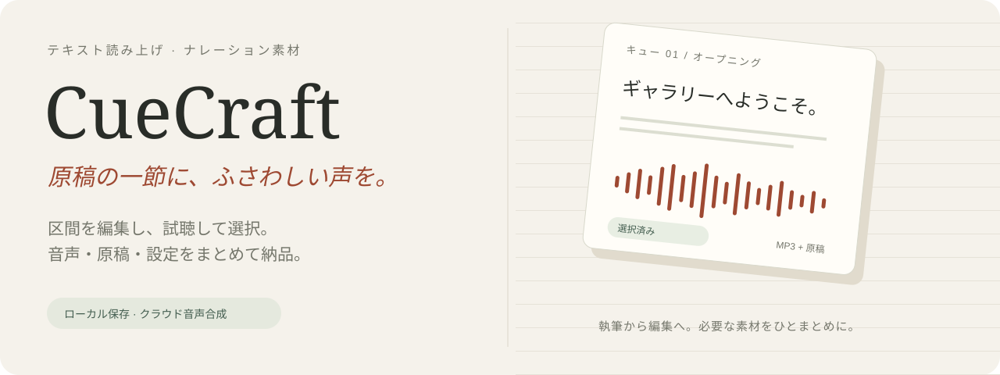
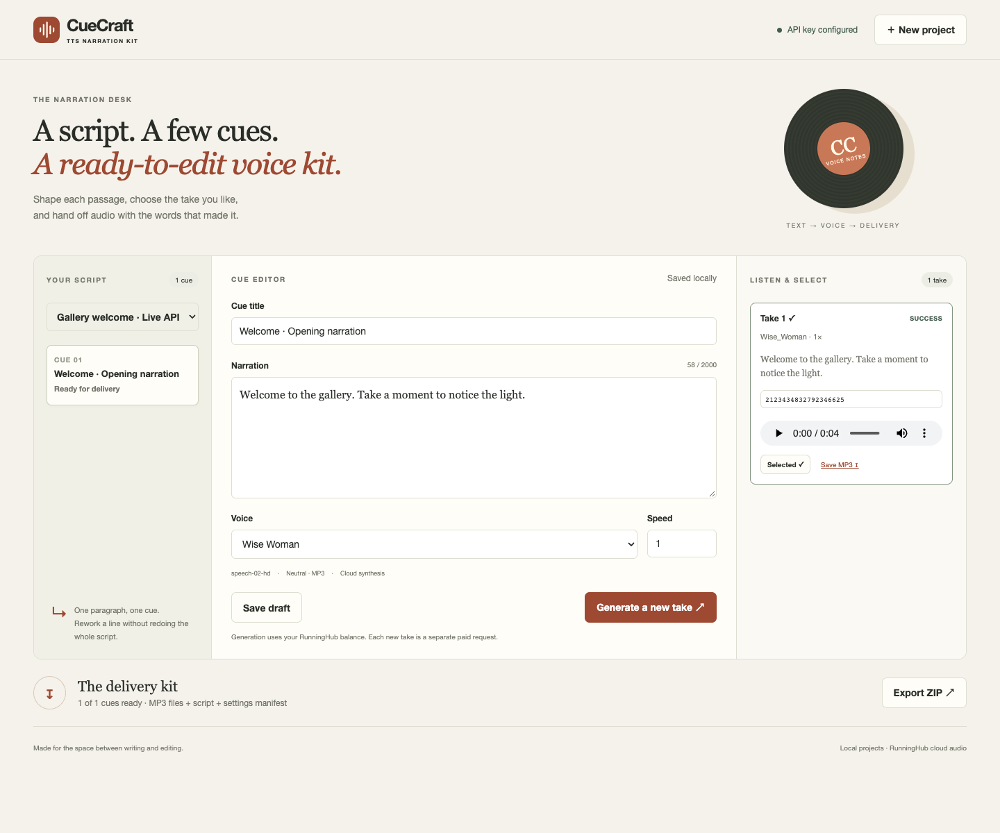
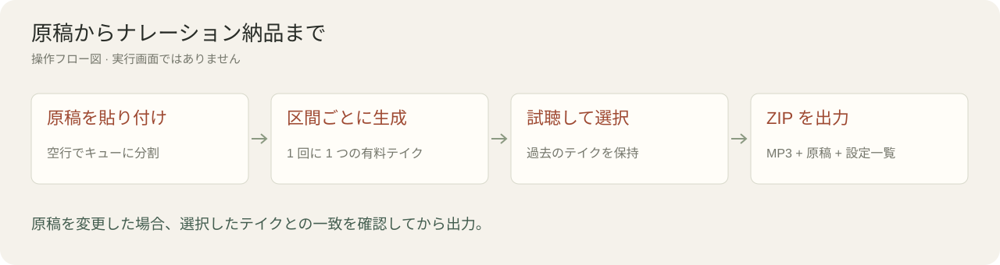
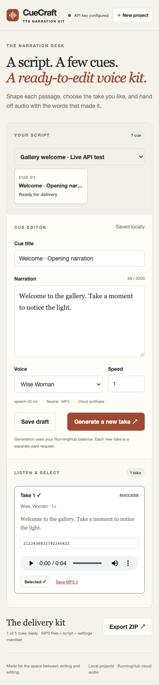

# CueCraft · TTS ナレーション納品ツール

[简体中文](README.md) · [English](README.en.md) · [日本語](README.ja.md)



**原稿を区間ごとに音声化し、試聴・選択して、そのまま納品できる素材一式へ。** CueCraft は RunningHub のマルチモーダル API を使うローカル TTS（text-to-speech）ツールです。原稿を貼り付ける → 区間ごとに生成する → テイクを選ぶ → 番号付き音声・原稿・設定一覧を出力します。

講座の解説、展示ガイド、短編動画のナレーションに適しています。GPU やローカル音声モデルは不要です。音声合成には RunningHub の `speech-02-hd` を使用します。

[機能](#features) · [インストール](#install) · [はじめての操作](#first-use) · [設定](#settings) · [タスク復旧](#recovery) · [API](#api) · [データ](#data) · [FAQ](#faq) · [検証](#validation) · [商業パートナーシップ](#sponsor)

## 画面と操作の流れ



実際に本ツールを起動し、API 呼び出しを完了した後のスクリーンショットです。画面は英語表示で、3 言語のガイドは同じ機能を説明しています。表示されているタスク ID はテスト用の識別子であり、API キーではありません。



<details><summary>実際のモバイル画面を見る</summary>



</details>

<a id="features"></a>

## 実装済みの機能

- 空行で原稿をキュー（区間）に分割。複数のローカルプロジェクトを保存し、区間ごとにタイトル・本文・音声・速度を編集できます。
- 1 回につき 1 区間を生成します。バックグラウンドで一括課金処理は行いません。過去のテイクを残して試聴し、納品用を選択できます。
- テイクごとに生成時のパラメータを保存。原稿を保存し直すと、不一致のテイクに表示が付きます。出力には、すべての選択済みテイクが現在の本文・音声・速度と一致している必要があります。
- SQLite にタスク ID と履歴を保存。ページの再読み込みやサーバー再起動後も、再生成せずに照会を続けられます。
- 完成した音声を本機に保存。ページ内再生、個別 MP3 ダウンロード、ZIP 一括出力に対応します。
- API キーがなくても原稿を準備・保存できます。キーはサーバー側だけで使用します。

電子書籍全体の変換ツールではありません。声のクローン、音声編集、ミキシング、字幕の時間合わせ、翻訳、区間の連続再生、自動連結は行いません。ZIP 内では区間ごとに独立した音声ファイルになります。

<a id="install"></a>

## インストールと起動

### 必要なもの

- **Python 3.10 以降**、pip、モダンブラウザー。
- モデル利用権限と残高のある有効な RunningHub API キー。
- RunningHub と音声 CDN に接続できるネットワーク。

ファイルを取得したら、`app.py` がある `cuecraft-tts-studio` ディレクトリに移動してください。Node.js、フロントエンドのビルド、ComfyUI は不要です。

**macOS / Linux：**

```bash
cd cuecraft-tts-studio
python3 -m venv .venv
source .venv/bin/activate
python -m pip install -r requirements.txt
cp .env.example .env
```

**Windows PowerShell：**

```powershell
cd cuecraft-tts-studio
py -3 -m venv .venv
.\.venv\Scripts\python.exe -m pip install -r requirements.txt
Copy-Item .env.example .env
```

テキストエディターで `.env` を開き、`RUNNINGHUB_API_KEY=` の後に自分のキーを記入して保存します。既存設定を上書きしないでください。既定の接続先は `https://www.runninghub.cn` です。国際版アカウントでは `https://www.runninghub.ai` を指定できます。キーに対応するリージョンを使用してください。

**同じプロジェクトディレクトリで起動：**

```bash
# macOS / Linux：仮想環境を有効化した状態
python app.py
```

```powershell
# Windows PowerShell：有効化スクリプトは不要
.\.venv\Scripts\python.exe app.py
```

**http://127.0.0.1:8791** を開きます。`python-dotenv` がプロジェクト直下の `.env` を読み込みます。すでにプロセスに設定されている環境変数が優先されます。設定変更後はサーバーを再起動してください。“API key configured” はキーの設定有無を示すだけで、認証・残高・利用権限の確認結果ではありません。

個人のローカル利用向けに `127.0.0.1` で待ち受けます。アカウント機能はないため、そのままインターネットに公開しないでください。終了するには `Ctrl+C` を押します。

### ディレクトリ構成

```text
cuecraft-tts-studio/
├── app.py                 # HTTP ルート、タスク管理、出力
├── cuecraft/
│   ├── provider.py        # RunningHub 認証、通信、ダウンロード
│   └── store.py           # SQLite のプロジェクト・区間・テイク
├── static/                # 実際の画面、スタイル、操作処理
├── assets/                # カバー、画面、実音声サンプル、正式ロゴ
├── examples/              # キーを含まない原稿例
├── tests/                 # オフライン統合テスト
├── .env.example           # キーが空の設定テンプレート
├── requirements.txt
└── data/                  # 初回起動時に作成。コミット対象外
```

<a id="first-use"></a>

## はじめてのナレーション作成

1. **New project** をクリックし、タイトルと原稿を入力します。空行で区間を分けます。通常の改行 1 つは同じ区間内に残ります。
2. **Load sample text** では Sample と明示された原稿を読み込めます。[原稿例](examples/gallery-script.txt)をコピーしても構いません。これはテキストのみで、音声はまだ生成されません。
3. **Create cues** をクリックし、左側から編集する区間を選びます。
4. タイトル、Narration、Voice、Speed を編集し、**Save draft** で保存します。区間を切り替える際は先に現在の編集内容を保存します。未保存の本文は再読み込み後に残りません。
5. **Generate this cue** をクリックします。有料 API を呼び出すため、最初は下記の短文をお勧めします。
6. 右側にテイクとコピー可能なタスク ID が表示されます。ページを開いている間、現在のプロジェクトで実行中のタスクを 4 秒ごとに照会します。成功すると MP3 を本機に保存し、プレーヤーを表示します。
7. 最初に成功したテイクが自動選択されます。後のテイクは以前の選択を上書きしません。納品用は **Use this take** で選択します。
8. すべての区間で一致する音声を選択したら、**Export ZIP** をクリックします。個別ファイルは **Save MP3** で保存できます。

新しいテイクの生成は再度課金対象になるため、確認が表示されます。照会やダウンロードの再試行は生成 API を呼び出しません。実際の料金は RunningHub の現在の価格とアカウント条件に従います。

### 実際の入力・出力例

入力：

```text
Welcome to the gallery. Take a moment to notice the light.
```

設定：`voice_id=Wise_Woman`、`speed=1`、`volume=1`、`pitch=0`、`emotion=neutral`。2 つの真偽値パラメータはどちらも `false` です。

[実際に生成したテスト音声を試聴・ダウンロード](assets/sample-narration.mp3)。実 API の出力であり、ブラウザーの読み上げや模擬応答ではありません。長さなどの検証結果は [VALIDATION.md](VALIDATION.md) に記載しています。

納品ファイル構成：

```text
cuecraft-narration-kit.zip
├── 01-<cue-id>.mp3
├── 02-<cue-id>.mp3         # 2 番目の区間があり、生成済みの場合
├── script.md              # 選択音声と一致する原稿
└── manifest.json          # 順序、タスク ID、音声、生成設定一式
```

番号は作成時の段落順です。現在の版では区間の追加・削除・並べ替え、ZIP の再インポートに対応していません。構成を変える場合は新規プロジェクトを作成してください。区間タイトルの変更は音声の一致判定に影響しません。

<a id="settings"></a>

## 設定と制限

| 設定 | 本ツールの動作 |
|---|---|
| プロジェクト / 区間タイトル | 1～100 文字。モデルへ送信しません |
| Script | 合計 40,000 文字まで、1～30 区間、各区間 1～2,000 文字。本ツール独自の制限です |
| Voice | 公式文書に記載された 17 種類から選択。既定値 `Wise_Woman` |
| Speed | `0.50～2.00`、刻み `0.01`、既定値 `1` |
| 固定パラメータ | `volume=1`、`pitch=0`、`emotion=neutral` |
| 真偽値パラメータ | `enable_base64_output=false`、`english_normalization=false` |
| 出力 | 公式の例は MP3。本ツールは MP3 ヘッダーを検証し、1 ファイル 50 MiB まで保存します |
| PORT | 既定値 `8791`。使用中なら `.env` で変更します |
| CUECRAFT_DATA_DIR | 任意の非公開データディレクトリ。絶対パスを推奨。既定値はプロジェクト内の `data/` |

API 自体には音量、音程、感情、発音辞書などもありますが、本ツールで変更できるのは音声と速度です。公式 schema に本文の最大長は定義されていません。2,000 文字は本ツール側の控えめな制限です。言語や音声による違いは納品前に試聴してください。

<a id="recovery"></a>

## テイクの保持とタスク復旧

**再読み込み / 再起動：** 区間とテイクは SQLite に保存され、ブラウザーは直前のプロジェクトを記憶します。開き直すと記録を読み込み、`RUNNING/QUEUED` のタスクを照会するだけで、自動再生成はしません。ページを閉じている間はバックグラウンド照会を行いません。

**原稿の変更：** 保存後、過去のテイクに “Saved draft differs” が表示されることがあります。再生と個別保存はできますが、新しい原稿と一緒に ZIP 出力はできません。一致する新テイクを生成・選択するか、テイクに表示された元の本文・音声・速度に戻して保存してください。

**送信結果が不明：** サーバーは送信前に `SUBMITTING` を記録します。遠隔側でタスク作成済みでも通信がタイムアウトする場合があるため、`UNKNOWN` として同じ区間の再生成を止めます。RunningHub の履歴で本文・時刻・アカウント・ID を確認し、**Attach task ID** → **Retry query** の順に操作してください。同じタスクの照会を再開します。作成されていないことを確認した場合に限り **No remote task** で解除してください。その後の生成は新しい有料リクエストです。

**照会 / ダウンロードの失敗：** エラーを表示して自動照会を一時停止します。**Retry query** で照会と保存を再試行でき、再合成はしません。自動照会は 15 分で一時停止します。手動で再開できます。遠隔タスクのキャンセルは行いません。

接続タイムアウトは 10 秒、応答読み取りは 60 秒、音声ダウンロードの読み取りは 45 秒です。再起動時に残った `SUBMITTING` は `UNKNOWN` に変わります。同じ送信 token は同じローカル記録を再利用します。これは RunningHub 側の冪等性保証ではなく、DB の削除や別データディレクトリでの実行には適用されません。

<a id="api"></a>

## RunningHub API との接続

[公式 speech-02-hd 文書](https://pre.runninghub.cn/runninghub-api-doc-cn/api-448183275)を 2026-11-19 に確認しました。認証付きの通信は Python サーバーが行い、ブラウザーに API キーを渡しません。

| 操作 | メソッドとパス | リクエスト / レスポンス |
|---|---|---|
| 送信 | `POST /openapi/v2/rhart-audio/text-to-audio/speech-02-hd` | JSON 設定 → `taskId`、`status` |
| 照会 | `POST /openapi/v2/query` | `{"taskId":"..."}` → `status`、`results[].url`、`outputType` |
| 保存 | 返された HTTPS URL に GET | API キーは付けず、MP3 を本機へ保存 |

2 つの POST は `Authorization: Bearer <RUNNINGHUB_API_KEY>` と JSON を使用します。入力は文字と音声設定のみで、参照録音は使わないため、アップロード API は不要です。

実際の送信形式：

```json
{
  "text": "Welcome to the gallery.",
  "voice_id": "Wise_Woman",
  "speed": 1,
  "volume": 1,
  "pitch": 0,
  "emotion": "neutral",
  "enable_base64_output": false,
  "english_normalization": false
}
```

サーバーは `taskId` を保存し、`QUEUED/RUNNING/SUCCESS/FAILED` を処理します。成功時は `results[0].url` をダウンロードします。空の結果、不明な状態、不正な JSON、認証エラー、ネットワークのタイムアウトには明確なメッセージを返します。遠隔側の失敗詳細はタスク ID を使って RunningHub で確認してください。応答全文やキーはログに出しません。

<a id="data"></a>

## データ・キー・保存先

- 原稿、設定、タスク ID、テイクのスナップショットは `data/cuecraft.sqlite3` に保存します。音声も同じディレクトリに置きます。ブラウザーの localStorage には最近のプロジェクト ID と送信確認用 token だけを保存します。
- 生成時には**選択中の区間の本文と音声設定を RunningHub へ送信**します。サービス側のデータ処理はその規約に従います。本ツールはゼロ保持を保証しません。
- 保存完了後の再生・出力は本機のファイルを利用し、一時的な遠隔 URL に依存しません。ページを閉じている間は未完了の音声を自動保存しません。
- `.env`、`data/`、仮想環境は Git の対象外です。独自指定した非公開データディレクトリも公開しないでください。ZIP には原稿とタスク ID が入るため、共有前に内容を確認してください。
- バックアップはサーバー停止後にデータディレクトリ全体をコピーします。削除するとプロジェクトと音声が永久に失われます。クラウド同期や画面内の削除機能はありません。

<a id="faq"></a>

## よくある問題

| 症状 | 対処 |
|---|---|
| API key missing | `.env` の名前と値を確認し、Python を再起動。画面にキーを入力する必要はありません |
| 認証 / 利用権限エラー | キー、リージョン、モデル権限、残高を確認。有料送信を自動再試行しません |
| ID がなく UNKNOWN と表示 | 履歴を確認し、正しい ID を Attach task ID で紐付けます。むやみに再生成しないでください |
| 長い待ち時間 | Retry query で照会を継続。15 分の上限は本機の自動照会を止めるだけです |
| 成功したのにプレーヤーがない | ダウンロードや形式検証が失敗した可能性があります。照会を再試行し、CDN 接続を確認 |
| Export ZIP が無効 | 全区間で一致する成功テイクを選択し、未保存の編集を保存してください |
| 編集後も旧音声が残る | 版を残す仕様です。新原稿と一致するテイクを選択します |
| データが見当たらない | `CUECRAFT_DATA_DIR` と起動したプロジェクトのコピーを確認。DB を削除しないでください |
| ポートが使用中 | `.env` の `PORT` を変えて再起動し、変更後のポートを開きます |

<a id="validation"></a>

## 検証状況と制限

この Mac 上で新しい仮想環境から依存関係をインストールし、実際の Chromium 画面を操作しました。短文を 1 回生成し、終端状態の照会、MP3 保存・再生、ZIP 出力、ページ再読み込みによる復元を確認済みです。異常系と重複送信防止はオフライン統合テストで確認しています。環境と測定値は [VALIDATION.md](VALIDATION.md) を参照してください。

プロジェクトディレクトリで実行：

```bash
python -m unittest discover -v
```

Windows は `.\.venv\Scripts\python.exe -m unittest discover -v` を使用します。このテストは有料 API を呼びません。Windows/Linux 実機、全音声・全言語、長文、`.ai` リージョンでの実生成は未検証です。個人のローカル利用向けで、複数ユーザーの公開サービスではありません。

<a id="sponsor"></a>

## 商業提携 · スポンサー

<p align="center"><a href="https://www.runninghub.ai/call-api?source=github"></a></p>

<h3 align="center">RunningHub API</h3>

Seedance、Kling、MiniMax、Nano Banana、Veo など、**400 種類以上の主要 AI モデル**を、競争力のある価格で API 経由で利用できます。

**高並列処理に対応 · 無料 API テスト · エンドツーエンド暗号化**

- フル機能の Seedance API を大幅割引で提供。オンラインツールは **1 秒あたり 0.21 人民元から**、**60〜80% のコスト削減**を実現。
- 安定した高並列処理と柔軟な従量課金。必要な分だけチャージでき、セット契約、待ち行列、抽選式の利用枠は不要。
- 無限キャンバス、ComfyUI、Agent などのオンラインツールで、脚本から完成映像まで制作を支援。
- LLM API、マルチモーダル API、ワークフロー API、AI アプリにワンストップでアクセス。
- **400 種類以上の主要モデル、8,000 以上のバージョン**から選択可能。国際版へのアクセスにも対応。
- 数千社の企業に信頼され、**月間アクティブユーザー 500 万人**の利用実績。

本プロジェクトは RunningHub の支援を受けています。単一の API で 400 種類以上の主要モデルに接続できます。

**[API を無料で試す](https://www.runninghub.ai/call-api?source=github)**

RunningHub の割引・無料テストのお問い合わせは [zhenyuedong@haima.me](mailto:zhenyuedong@haima.me) まで。

## 参考とライセンス

製品調査では [ebook2audiobook](https://github.com/DrewThomasson/ebook2audiobook) と [TTS-WebUI](https://github.com/rsxdalv/TTS-WebUI) を参考にしました。候補、スター数の出典、既存作品との差異は [RESEARCH.md](RESEARCH.md) に記載しています。コードとビジュアルは独自実装です。

コードは [MIT ライセンス](LICENSE) です。RunningHub の正式ロゴと宣伝文はユーザー提供で、権利は各権利者に帰属します。上記の宣伝数値は提供文書に基づき、本ツールで実測した価格・性能ではありません。参考用のプレビュー画像 2 枚は使用していません。

GitHub にはまだ公開していません。推奨リポジトリ名：`cuecraft-tts-studio`。
