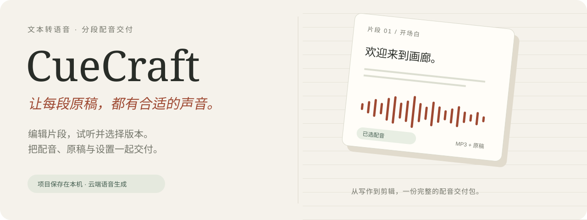
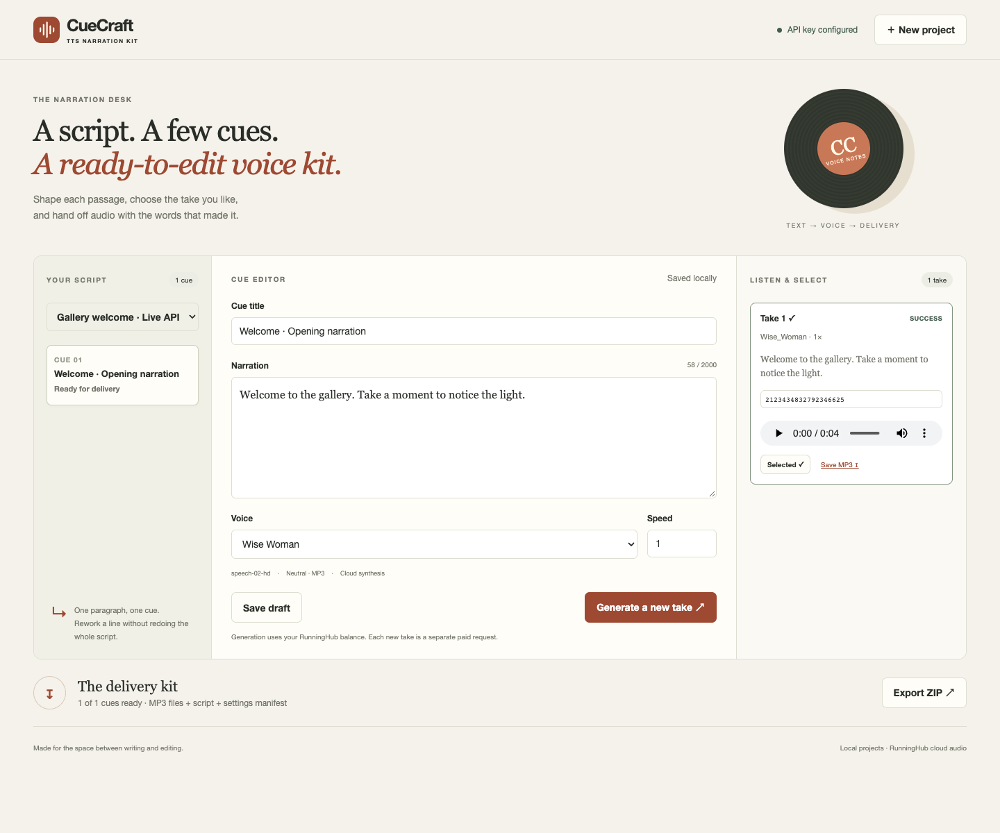
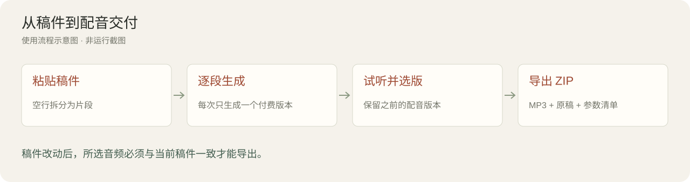
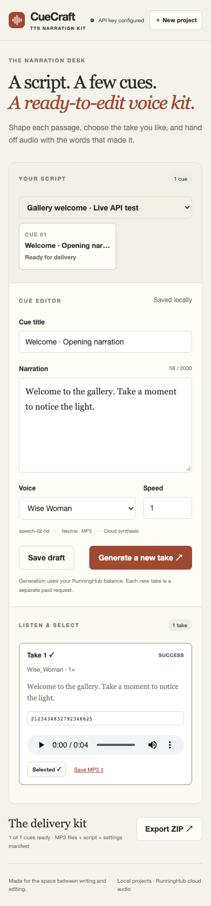

# CueCraft · TTS 配音交付工具

[简体中文](README.md) · [English](README.en.md) · [日本語](README.ja.md)



**把分段稿件变成可试听、可选版、可交付的配音包。** CueCraft 是基于 RunningHub 多模态 API 的本地 TTS（text-to-speech）工具：粘贴文字 → 逐段生成配音 → 选择版本 → 导出编号音频、原稿和参数清单。

适合课程讲解、展览导览和短视频旁白。无需 GPU 或本地语音模型；文本转音频由 RunningHub 的 `speech-02-hd` 完成。

[功能](#features) · [安装](#install) · [第一次使用](#first-use) · [参数](#settings) · [任务恢复](#recovery) · [API](#api) · [数据](#data) · [常见问题](#faq) · [验证](#validation) · [商业合作](#sponsor)

## 界面与流程



上图来自本项目实际运行页面，展示一次真实 API 调用后的结果。界面使用英文；三份使用文档完整对应。任务 ID 是测试任务编号，不是密钥。



<details><summary>查看移动端真实页面</summary>



</details>

<a id="features"></a>

## 已实现功能

- 按空行把稿件拆成独立 cue；保存多个本地项目，逐段编辑标题、文字、音色与语速。
- 每次只生成一个 cue，不在后台批量消耗额度。旧 take 保留，可重复试听和选择交付版本。
- 每个 take 保存当时的完整生成参数。修改已保存稿件后，旧版标记为不匹配；导出要求所有片段的所选音频与当前保存稿件一致。
- 本地 SQLite 保存任务 ID 和版本；刷新后恢复，重启后继续查询。提交和查询重试明确分开。
- 成功音频保存到本机，支持页面播放器、单个 MP3 下载、完整 ZIP 导出。
- 缺少密钥时仍可整理稿件。密钥只留在服务端。

这不是整本电子书转换器，不提供声音克隆、音频剪辑、混音、字幕对齐、翻译、连续播放或自动拼接。ZIP 中每段是独立文件。

<a id="install"></a>

## 安装与启动

### 前提

- Python **3.10 或更高版本**、pip 和现代浏览器。
- 一个有效的 RunningHub API Key、相应模型权限和余额。
- 能访问 RunningHub 与其音频 CDN 的网络。

取得本项目文件后，进入包含 `app.py` 的 `cuecraft-tts-studio` 目录。无需 Node.js、前端构建或 ComfyUI。

**macOS / Linux：**

```bash
cd cuecraft-tts-studio
python3 -m venv .venv
source .venv/bin/activate
python -m pip install -r requirements.txt
cp .env.example .env
```

**Windows PowerShell：**

```powershell
cd cuecraft-tts-studio
py -3 -m venv .venv
.\.venv\Scripts\python.exe -m pip install -r requirements.txt
Copy-Item .env.example .env
```

用文本编辑器打开 `.env`，在 `RUNNINGHUB_API_KEY=` 后填写自己的密钥并保存。不要覆盖已有配置。默认地区为 `https://www.runninghub.cn`；国际站账户可设置 `https://www.runninghub.ai`，应使用与密钥一致的地区。

**启动（仍在项目目录）：**

```bash
# macOS / Linux，已激活虚拟环境
python app.py
```

```powershell
# Windows PowerShell，无需激活脚本
.\.venv\Scripts\python.exe app.py
```

打开 **http://127.0.0.1:8791**。程序会通过 `python-dotenv` 自动加载项目根目录 `.env`；已有进程环境变量优先。修改配置后重启服务。页面的 “API key configured” 仅表示已配置密钥，不表示余额或权限已经验证。

程序绑定 `127.0.0.1`，用于个人本机工作，没有账号系统，不要直接暴露到公网。按 `Ctrl+C` 停止服务。

### 目录结构

```text
cuecraft-tts-studio/
├── app.py                 # HTTP 路由、任务生命周期和导出
├── cuecraft/
│   ├── provider.py        # RunningHub 鉴权、请求与下载
│   └── store.py           # SQLite 项目、片段、版本记录
├── static/                # 实际网页、样式与交互
├── assets/                # 封面、截图、真实示例与正式 logo
├── examples/              # 不含密钥的示例稿件
├── tests/                 # 离线集成测试
├── .env.example           # 空白密钥配置模板
├── requirements.txt
└── data/                  # 首次运行创建；不提交
```

<a id="first-use"></a>

## 第一次使用

1. 点击 **New project**，填写项目标题和稿件。空行分隔不同片段；普通单个换行留在同一片段内。
2. 可点击 **Load sample text** 载入明确标注为 Sample 的示例稿件；这只是文字，没有生成音频。也可复制 [示例稿件](examples/gallery-script.txt)。
3. 点击 **Create cues**。左侧出现片段列表，点击片段进入编辑器。
4. 编辑标题、Narration、Voice 和 Speed，点击 **Save draft**。切换片段会先保存当前编辑；刷新前未保存的文字不持久化。
5. 点击 **Generate this cue**。该操作会调用付费 API；首次测试建议只用下面这句短文字。
6. 右侧出现 take 和可复制的任务 ID。页面每 4 秒查询当前项目中正在执行的任务；生成成功后自动下载 MP3，出现真实播放器。
7. 第一份成功音频自动选中。以后生成的新版本不会覆盖旧版本，通过 **Use this take** 选择要交付的版本。
8. 每段都有匹配的所选音频后，点击 **Export ZIP**。只需要一段时用 **Save MP3**。

生成新版本会再次计费，界面会提示确认；查询和下载重试不会调用生成接口。配置可能影响费用，实际计费以 RunningHub 控制台为准。

### 真实输入输出示例

输入：

```text
Welcome to the gallery. Take a moment to notice the light.
```

参数：`voice_id=Wise_Woman`，`speed=1`，`volume=1`，`pitch=0`，`emotion=neutral`，两个布尔参数均为 `false`。

[下载/试听真实测试音频](assets/sample-narration.mp3)。该文件来自本次真实调用，不是浏览器合成语音或模拟响应。时长与验证记录见 [VALIDATION.md](VALIDATION.md)。

交付包结构：

```text
cuecraft-narration-kit.zip
├── 01-<cue-id>.mp3
├── 02-<cue-id>.mp3         # 有第二段且已生成时
├── script.md              # 与所选音频一致的稿件
└── manifest.json          # 文件顺序、任务 ID、音色及完整生成参数
```

文件编号保持创建时的段落顺序；当前版本不支持片段增删、重排或导入 ZIP，改变结构时新建项目。标题可随时修改，不影响音频一致性校验。

<a id="settings"></a>

## 关键参数与限制

| 设置 | 本项目行为 |
|---|---|
| 项目标题 / 片段标题 | 1–100 字符；标题不发送给模型 |
| Script | 最多 40,000 字符、1–30 段；每段 1–2,000 字符，均为本项目限制 |
| Voice | 从文档列出的 17 个系统音色中选择；默认 `Wise_Woman` |
| Speed | `0.50–2.00`，步长 `0.01`，默认 `1` |
| 固定参数 | `volume=1`、`pitch=0`、`emotion=neutral` |
| 布尔参数 | `enable_base64_output=false`、`english_normalization=false` |
| 输出 | 文档示例为 MP3；本工具接受 MP3 文件头，单文件下载上限 50 MiB |
| PORT | 默认 `8791`；端口被占用时在 `.env` 修改 |
| CUECRAFT_DATA_DIR | 可选私有数据目录，建议使用绝对路径；默认项目下 `data/` |

原接口还提供音量、音高、情绪、发音字典等参数。本工具仅开放音色和语速，避免将未实现的控件写成支持功能。官方 schema 没有声明文字长度上限；2,000 字符是本工具的保守限制。不同语言及音色效果需要用户自行试听。

<a id="recovery"></a>

## 保留版本与恢复任务

**正常刷新 / 重启：** 片段和 take 保存在 SQLite；浏览器记住最近项目。重新打开页面会载入记录，只查询 `RUNNING/QUEUED`，不会自动生成新版本。没有打开网页时不会在后台轮询；重新打开即可继续。

**修改稿件：** 保存后旧 take 显示 “Saved draft differs”。它仍可播放和单独下载，但不允许与新稿件一起打包。可以生成并选择新版，或者恢复成旧 take 中显示的原文字、音色和语速，再保存。

**提交结果未知：** 服务端先记录 `SUBMITTING` 再发请求。网络超时可能意味着远端已建任务，因此变为 `UNKNOWN` 并锁住该片段的再次生成。去 RunningHub 核对文本、时间、账户和任务 ID，点击 **Attach task ID**，再点 **Retry query**。这只查询同一任务。只有确认远端没有创建任务后，才使用 **No remote task** 解锁；之后生成是新的付费调用。

**查询 / 下载出错：** 自动查询暂停并显示错误。点击 **Retry query** 继续查询和下载，不会重新合成。连续自动查询最多运行 15 分钟，之后手动恢复；远端任务不会因此取消。

请求超时为连接 10 秒、读取 60 秒，下载读取超时 45 秒。重启时未完成的 `SUBMITTING` 会转换为 `UNKNOWN`。相同提交 token 只复用本地记录；这不是 RunningHub 的服务端幂等保证，删除数据库或在多个独立数据目录运行会失去这项保护。

<a id="api"></a>

## RunningHub API 接入

[官方 speech-02-hd 文档](https://pre.runninghub.cn/runninghub-api-doc-cn/api-448183275)（2026-11-19 核实）。所有请求由 Python 服务端发出，浏览器不持有 API Key。

| 操作 | 方法与路径 | 请求 / 响应 |
|---|---|---|
| 提交 | `POST /openapi/v2/rhart-audio/text-to-audio/speech-02-hd` | JSON 生成参数 → `taskId`、`status` |
| 查询 | `POST /openapi/v2/query` | `{"taskId":"..."}` → `status`、`results[].url`、`outputType` |
| 保存 | 对结果的 HTTPS URL 发出 GET | 不携带 API Key；保存 MP3 到本机 |

两个 POST 都使用 `Authorization: Bearer <RUNNINGHUB_API_KEY>` 和 JSON。未使用文件上传接口：输入只有文字和语音设置，不需要上传录音。

本工具提交的实际结构：

```json
{
  "text": "Welcome to the gallery.",
  "voice_id": "Wise_Woman",
  "speed": 1,
  "volume": 1,
  "pitch": 0,
  "emotion": "neutral",
  "enable_base64_output": false,
  "english_normalization": false
}
```

服务端保存 `taskId`，处理 `QUEUED/RUNNING/SUCCESS/FAILED`。成功后取 `results[0].url` 下载；空结果、未知状态、非法 JSON、鉴权错误和网络超时会反馈明确错误。远端失败详情可凭任务 ID 在 RunningHub 控制台查看；不把完整上游响应或密钥写进日志。

<a id="data"></a>

## 数据、密钥与保存方式

- 原稿、设置、任务 ID、版本快照保存在本机 `data/cuecraft.sqlite3`；音频保存在同目录。浏览器只用 localStorage 保存最近项目 ID 和待确认提交 token。
- 点击生成后，**当前片段文字和语音参数会发送到 RunningHub**。服务商的数据处理以其条款为准；此工具不作零留存承诺。
- 下载成功后播放和导出读取本地音频，不依赖远端临时链接。网页关闭期间不会自动下载尚未完成的音频。
- `.env`、`data/` 和虚拟环境均被 Git 忽略；请勿上传自己的私有数据目录。ZIP 含原稿和任务 ID，分享前自行核对内容。
- 关闭服务后可备份整个数据目录；删除该目录会永久清除项目和本地音频。当前无云同步或 UI 删除入口。

<a id="faq"></a>

## 常见问题

| 现象 | 处理 |
|---|---|
| API key missing | 检查 `.env` 变量名和非空值，重启 Python；无需在网页输入密钥 |
| 鉴权 / 权限失败 | 检查密钥、站点地区、模型权限和余额；不会自动重试付费提交 |
| 没有任务 ID，显示 UNKNOWN | 到控制台核对任务，再 Attach task ID；不要盲目重新生成 |
| 长时间排队 | 继续 Retry query；页面 15 分钟后仅暂停本地轮询 |
| 已成功但没有播放器 | 下载或响应校验失败会保留任务 ID；Retry query；检查 CDN 网络 |
| Export ZIP 不可点击 | 每段都需成功且所选版本与保存稿件一致；先保存当前编辑 |
| 改文字后旧音频仍在 | 这是版本保留行为；选择与新稿件一致的新 take |
| 数据不见了 | 检查 `CUECRAFT_DATA_DIR` 和启动目录中的项目副本；不要删除数据库 |
| 端口被占用 | 修改 `.env` 中的 `PORT` 后重启，访问对应端口 |

<a id="validation"></a>

## 验证状态与限制

本机已从新虚拟环境安装依赖并启动，运行真实 Chromium 页面，完成一次短文本的 RunningHub 提交、终态查询、MP3 下载、播放、ZIP 导出和刷新恢复。离线集成测试覆盖异常及重复提交保护。详细环境和测量结果见 [VALIDATION.md](VALIDATION.md)。

在项目目录运行：

```bash
python -m unittest discover -v
```

Windows 使用 `.\.venv\Scripts\python.exe -m unittest discover -v`。这些测试不调用付费 API。尚未在 Windows/Linux 实机、多种音色/语言、长文本及 `.ai` 站点完成真实生成验证。项目面向个人本地使用，非多用户部署服务。

<a id="sponsor"></a>

## 商业合作 · 赞助支持

<p align="center"><a href="https://www.runninghub.ai/call-api?source=github"></a></p>

<h3 align="center">RunningHub API</h3>

通过 API 接入 Seedance、Kling、MiniMax、Nano Banana、Veo 等 **400+ 主流模型**，享受极具竞争力的价格。

**高并发支持 · 免费 API 测试 · 端到端加密**

- Seedance 满血版 API 接入全网骨折价，在线工具低至 **0.21 元/秒**，节省 **60%–80% 成本**！
- 超稳定高并发高折扣，随用随充按需弹性付费，不捆绑不排队不抽卡。
- 无限画布、ComfyUI、Agent 等在线工具，从剧本到成片全链路制作。
- 一站式接入 LLM API、多模态 API、工作流 API、AI 应用。
- **400+ 主流模型**（支持国际版权限），**8000+ 版本**任选。
- 数千家企业信赖，**500 万 C 端月活**验证。

本项目由 RunningHub 提供支持，单一接口直连 400+ 主流大模型。

**[免费测试 API](https://www.runninghub.ai/call-api?source=github)**

RunningHub 折扣获取与免费测试联系 [zhenyuedong@haima.me](mailto:zhenyuedong@haima.me)。

## 参考与许可

产品调研参考 [ebook2audiobook](https://github.com/DrewThomasson/ebook2audiobook) 和 [TTS-WebUI](https://github.com/rsxdalv/TTS-WebUI)。详细候选方向、星标来源和差异见 [RESEARCH.md](RESEARCH.md)。代码与视觉独立实现。

代码采用 [MIT 许可证](LICENSE)。RunningHub 正式 logo 与宣传文案由用户提供，品牌素材归原权利人；上方商业数据来自提供的宣传文档，不代表本项目实测价格或性能。没有使用两张参考预览图。

尚未发布到 GitHub；建议仓库名 `cuecraft-tts-studio`。
